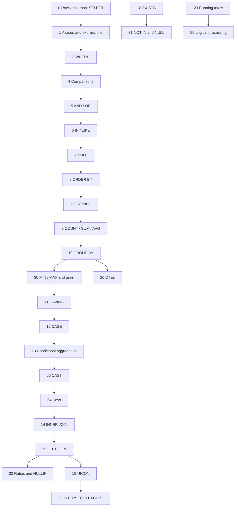

# Prerequisite map

Declared prerequisites live on each lesson as `prereq: number[]`. `recommendation()` in `src/lib/learning-state.ts` uses the first declared prerequisite the learner has not mastered. It does not check whether that lesson is earlier in `courseOrder`. A forward id sends a struggling learner to a concept they have not reached yet.

Positions below are 1-based places in the current `courseOrder`. The proposed path is [CURRENT_TO_PROPOSED_ORDER.md](CURRENT_TO_PROPOSED_ORDER.md). Nothing in this file has been applied to the curriculum.

## Actual early dependencies

These are the techniques the challenges use, read from the task text and the example.

Lesson 54’s second challenge is an inner join. The graph still places keys immediately before lesson 14, because the concept (what a foreign key is) is the right preface to joins, and the next lesson teaches the join the challenge asks for. The challenge text stays.

## Forward prerequisites in the current order

| Lesson | Later prerequisite | Why it is a real dependency | Correction |
| --- | --- | --- | --- |
| 30 | 9 COUNT, position 13 | Challenge 2 also needs GROUP BY (lesson 10, position 14). | Move 30 to just after lesson 10. Record prerequisites `[9, 10]`. |
| 31 | 18 EXISTS, position 30 | The concept check is the NULL trap. Challenge 1 is “viewers who have not referred anyone,” and `referred_by` is nullable. | Move 31 to just after lesson 18. The array already includes 7 and 18. |
| 32 | 15 LEFT JOIN, position 22 | Challenge 2 keeps accounts with no requests. | Move 32 to just after lesson 15. The array already includes 13 and 15. |
| 55 | 23 running totals, position 37 | Challenge 2 adds `customer_units` with a window. | Move 55 to just after lesson 23. The array already includes 10, 11, and 23. |
| 35 | 27 recursive CTE, position 47 | The example and both challenges build a recursive date spine. | Do not move 35. Lesson 42 depends on 35 and sits earlier than 27. Change the array from `[27]` to `[14]` so recommendations stay on joins. The spine in the example remains content debt. |
| 20 | 19 UNION, position 46 | The example is `WITH totals AS (SELECT … GROUP BY …)`. It does not use UNION. | Do not move 20. Change the array from `[19]` to `[10]`. |
| 26 | 25 latest row, position 39 | The example groups `strftime('%Y-%m', ordered_at)`. | Do not move 26. Change the array from `[25]` to `[10]`. |
| 38 | 19 UNION, position 46 | INTERSECT and EXCEPT are taught while UNION is still ahead. | Move 19 to just before 38. |

Lesson 54 does not declare a later prerequisite. Its second challenge is still a join. The move puts that challenge one lesson before INNER JOIN. That is the smallest place it can sit without becoming the opening lesson.

## New forward pointers the moves would create

After the seven relocations, and before the array edits, four declared prerequisites would point at a later lesson:

| Lesson | Prerequisite that would point forward | Edit |
| --- | --- | --- |
| 3 WHERE | 2 DISTINCT, which moves to position 9 | `[2]` becomes `[1]`. WHERE follows aliases. |
| 19 UNION | 18 EXISTS, which stays at position 29 while UNION moves to position 26 | `[18]` becomes `[3]`. The example filters with WHERE and then stacks rows. |
| 26 dates | 25, still later | `[25]` becomes `[10]`, as above. |
| 35 cross join | 27, still later | `[27]` becomes `[14]`, as above. |

Lesson 20’s prerequisite (UNION) is earlier after the move, so it is no longer an inversion. The array still names the wrong concept, so it changes to `[10]` in the same implementation.

## Prerequisites that already point backward and should stay

The rest of the declared arrays point at earlier lessons today, and they still do after the seven moves. Examples that matter for the recommendation engine:

- Lesson 14 (INNER JOIN) declares lesson 13. Conditional aggregation stays before joins.
- Lesson 15 declares lesson 14. LEFT JOIN stays immediately after INNER JOIN.
- Lesson 42 declares lessons 23 and 35. Both stay earlier, which is why lesson 35 is not moved past the window block.
- Lesson 58 (CREATE TABLE) declares lesson 54. Keys move from position 5 to position 17 and remain far before DDL.
- Lesson 77 declares lesson 55. Logical processing moves later, to just after running totals, and remains before the integration lessons.

## What a group change does to “you should review”

Module completion is derived from `group`. Mastery is stored on the lesson id. Moving a lesson into another module changes which module card counts it. It does not change `stats[lessonId]`.

The weak-lesson recommendation follows `prereq`, not `group`. The array edits above are what keep that recommendation from sending someone forward after the reorder. Leaving the arrays untouched would make the path look right and the hint wrong.

## Declared prerequisites for every lesson

“Later now” means the declared prerequisite currently appears after the lesson in `courseOrder`. “Later proposed” is the same test after the seven relocations, before any prerequisite-array edit. The implementation plan’s array edits are listed in [SEQUENCE_IMPLEMENTATION_PLAN.md](SEQUENCE_IMPLEMENTATION_PLAN.md).

| ID | Title | Declared prerequisites | Later now | Later proposed |
| ---: | --- | --- | --- | --- |
| 0 | Meet your first SELECT | — | — | — |
| 1 | Aliases & calculated columns | 0 Meet your first SELECT | — | — |
| 2 | Unique values with DISTINCT | 1 Aliases & calculated columns | — | — |
| 3 | Filter with WHERE | 2 Unique values with DISTINCT | — | 2 |
| 4 | Comparisons & ranges | 3 Filter with WHERE | — | — |
| 5 | Combine conditions | 4 Comparisons & ranges | — | — |
| 6 | Lists & text patterns | 5 Combine conditions | — | — |
| 7 | Understand NULL | 6 Lists & text patterns | — | — |
| 8 | Sort & limit | 7 Understand NULL | — | — |
| 9 | COUNT, SUM & AVG | 8 Sort & limit | — | — |
| 10 | Group into summaries | 9 COUNT, SUM & AVG | — | — |
| 11 | Filter groups with HAVING | 10 Group into summaries | — | — |
| 12 | Make decisions with CASE | 11 Filter groups with HAVING | — | — |
| 13 | Conditional aggregation | 12 Make decisions with CASE | — | — |
| 14 | Connect tables with JOIN | 13 Conditional aggregation | — | — |
| 15 | Keep unmatched rows | 14 Connect tables with JOIN | — | — |
| 16 | Revenue across tables | 15 Keep unmatched rows | — | — |
| 17 | Subqueries | 16 Revenue across tables | — | — |
| 18 | Ask whether a row exists | 17 Subqueries | — | — |
| 19 | Combine sets with UNION | 18 Ask whether a row exists | — | 18 |
| 20 | Readable queries with CTEs | 19 Combine sets with UNION | 19 | — |
| 21 | Window functions: ROW_NUMBER | 20 Readable queries with CTEs | — | — |
| 22 | RANK & DENSE_RANK | 21 Window functions: ROW_NUMBER | — | — |
| 23 | Running totals | 22 RANK & DENSE_RANK | — | — |
| 24 | Compare rows with LAG | 23 Running totals | — | — |
| 25 | Latest row per group | 24 Compare rows with LAG | — | — |
| 26 | Dates & monthly analysis | 25 Latest row per group | 25 | 25 |
| 27 | Recursive CTEs | 26 Dates & monthly analysis | — | — |
| 28 | Query plans & indexes | 27 Recursive CTEs | — | — |
| 29 | Capstone: customer insights | 28 Query plans & indexes | — | — |
| 30 | MIN, MAX & the grain of a result | 9 COUNT, SUM & AVG | 9 | — |
| 31 | NOT IN and the NULL trap | 7 Understand NULL; 18 Ask whether a row exists | 18 | — |
| 32 | Ratios, ROUND & NULLIF | 13 Conditional aggregation; 15 Keep unmatched rows | 15 | — |
| 33 | Clean strings & cast values | 7 Understand NULL | — | — |
| 34 | Self-joins & referral relationships | 14 Connect tables with JOIN | — | — |
| 35 | CROSS JOIN & a complete date grid | 27 Recursive CTEs | 27 | 27 |
| 36 | FULL OUTER JOIN & unmatched records | 15 Keep unmatched rows | — | — |
| 37 | ON versus WHERE in a LEFT JOIN | 15 Keep unmatched rows | — | — |
| 38 | INTERSECT & EXCEPT | 19 Combine sets with UNION | 19 | — |
| 39 | Date boundaries & monthly buckets | 26 Dates & monthly analysis | — | — |
| 40 | LEAD & the next event | 24 Compare rows with LAG | — | — |
| 41 | FIRST_VALUE, LAST_VALUE & frames | 23 Running totals | — | — |
| 42 | Rolling averages & missing dates | 23 Running totals; 35 CROSS JOIN & a complete date grid | — | — |
| 43 | Share of total with windows | 20 Readable queries with CTEs; 32 Ratios, ROUND & NULLIF | — | — |
| 44 | Deduplicate event retries | 25 Latest row per group | — | — |
| 45 | Daily active users & engagement | 10 Group into summaries; 39 Date boundaries & monthly buckets | — | — |
| 46 | Ordered conversion funnels | 20 Readable queries with CTEs; 37 ON versus WHERE in a LEFT JOIN | — | — |
| 47 | Cohorts & exact-day retention | 18 Ask whether a row exists; 39 Date boundaries & monthly buckets | — | — |
| 48 | Sessionize an event stream | 24 Compare rows with LAG; 23 Running totals | — | — |
| 49 | Multi-grain joins without fan-out | 20 Readable queries with CTEs; 16 Revenue across tables | — | — |
| 50 | Revenue & payment reconciliation | 49 Multi-grain joins without fan-out | — | — |
| 51 | AI usage cost & contribution margin | 49 Multi-grain joins without fan-out; 32 Ratios, ROUND & NULLIF | — | — |
| 52 | Experiment conversion denominators | 18 Ask whether a row exists; 32 Ratios, ROUND & NULLIF | — | — |
| 53 | Top N per group & ties | 22 RANK & DENSE_RANK; 25 Latest row per group | — | — |
| 54 | Databases, schemas, tables & keys | 0 Meet your first SELECT | — | — |
| 55 | Logical query processing & row grain | 10 Group into summaries; 11 Filter groups with HAVING; 23 Running totals | 23 | — |
| 56 | CAST, text types & NULL arithmetic | 1 Aliases & calculated columns | — | — |
| 57 | NTILE & balanced ranking buckets | 22 RANK & DENSE_RANK | — | — |
| 58 | DDL: create, alter & inspect a table | 54 Databases, schemas, tables & keys | — | — |
| 59 | DML: INSERT, UPDATE & DELETE | 58 DDL: create, alter & inspect a table | — | — |
| 60 | Constraints protect the data contract | 58 DDL: create, alter & inspect a table | — | — |
| 61 | Transactions & savepoint recovery | 59 DML: INSERT, UPDATE & DELETE | — | — |
| 62 | Views: reusable query definitions | 20 Readable queries with CTEs | — | — |
| 63 | CTEs, CTAS & temporary tables | 20 Readable queries with CTEs | — | — |
| 64 | Triggers & visible audit effects | 59 DML: INSERT, UPDATE & DELETE | — | — |
| 65 | Stored procedures: parameters & contracts | 20 Readable queries with CTEs | — | — |
| 66 | Indexes: observe a real access path | 28 Query plans & indexes | — | — |
| 67 | SARGable ranges, not speed commandments | 39 Date boundaries & monthly buckets; 66 Indexes: observe a real access path | — | — |
| 68 | Partitioning & workload trade-offs | 39 Date boundaries & monthly buckets | — | — |
| 69 | Bronze: inspect raw data before cleaning | 44 Deduplicate event retries; 39 Date boundaries & monthly buckets | — | — |
| 70 | Silver: clean, map & deduplicate | 69 Bronze: inspect raw data before cleaning; 44 Deduplicate event retries | — | — |
| 71 | Gold: dimensions, facts & quality gates | 70 Silver: clean, map & deduplicate; 56 CAST, text types & NULL arithmetic | — | — |
| 72 | EDA: explore before telling the story | 71 Gold: dimensions, facts & quality gates | — | — |
| 73 | Customer & product reporting contracts | 72 EDA: explore before telling the story; 15 Keep unmatched rows | — | — |
| 74 | Monthly change & cumulative reports | 72 EDA: explore before telling the story; 24 Compare rows with LAG; 23 Running totals | — | — |
| 75 | Review AI-generated SQL with evidence | 32 Ratios, ROUND & NULLIF; 49 Multi-grain joins without fan-out | — | — |
| 76 | Reconcile extraction & Bronze ingestion | 69 Bronze: inspect raw data before cleaning | — | — |
| 77 | Integrate CRM + ERP with source authority | 76 Reconcile extraction & Bronze ingestion; 70 Silver: clean, map & deduplicate; 55 Logical query processing & row grain | — | — |
| 78 | Product validity with LEAD & half-open intervals | 24 Compare rows with LAG | — | — |
| 79 | Validate calendar dates before converting | 56 CAST, text types & NULL arithmetic | — | — |
| 80 | Quarantine bad rows & reconcile the batch | 79 Validate calendar dates before converting | — | — |
| 81 | Automated star-schema quality tests | 71 Gold: dimensions, facts & quality gates; 15 Keep unmatched rows | — | — |
| 82 | Durable surrogate keys across loads | 58 DDL: create, alter & inspect a table; 59 DML: INSERT, UPDATE & DELETE; 70 Silver: clean, map & deduplicate | — | — |
| 83 | Latest-state reporting versus SCD Type 2 | 78 Product validity with LEAD & half-open intervals; 82 Durable surrogate keys across loads | — | — |
| 84 | Idempotent incremental UPSERT & stale updates | 82 Durable surrogate keys across loads | — | — |
| 85 | Stage, validate & atomically promote a refresh | 61 Transactions & savepoint recovery; 81 Automated star-schema quality tests | — | — |
| 86 | Protect fact grain when joining versions | 83 Latest-state reporting versus SCD Type 2; 49 Multi-grain joins without fan-out | — | — |
| 87 | Capstone: integrated customers to trusted sales | 77 Integrate CRM + ERP with source authority; 80 Quarantine bad rows & reconcile the batch; 81 Automated star-schema quality tests; 85 Stage, validate & atomically promote a refresh; 86 Protect fact grain when joining versions | — | — |
