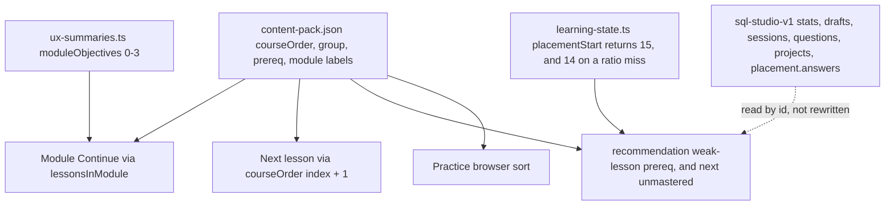

# Sequence implementation plan

**Applied** on branch `implement-learning-sequence`. See [SEQUENCE_IMPLEMENTATION_REPORT.md](SEQUENCE_IMPLEMENTATION_REPORT.md) for changed files, test results, and browser evidence.

The recommendation is the limited correction in [LEARNING_SEQUENCE_AUDIT.md](LEARNING_SEQUENCE_AUDIT.md). Seven existing lessons move. Six prerequisite arrays change so recommendations cannot point forward. Two module labels change so the module list matches what those modules contain. No lesson is added. No module index is added or renumbered. Lesson ids stay.

## Recommended course sequence

Positions are 1-based. The id is the stable lesson id.

| Pos | ID | Lesson | Module after the change |
| ---: | ---: | --- | --- |
| 1 | 0 | Meet your first SELECT | 0 SQL foundations |
| 2 | 1 | Aliases & calculated columns | 0 SQL foundations |
| 3 | 3 | Filter with WHERE | 1 Filtering & sorting |
| 4 | 4 | Comparisons & ranges | 1 Filtering & sorting |
| 5 | 5 | Combine conditions | 1 Filtering & sorting |
| 6 | 6 | Lists & text patterns | 1 Filtering & sorting |
| 7 | 7 | Understand NULL | 1 Filtering & sorting |
| 8 | 8 | Sort & limit | 1 Filtering & sorting |
| 9 | 2 | Unique values with DISTINCT | 2 Calculations & data quality |
| 10 | 9 | COUNT, SUM & AVG | 2 Calculations & data quality |
| 11 | 10 | Group into summaries | 2 Calculations & data quality |
| 12 | 30 | MIN, MAX & the grain of a result | 2 Calculations & data quality |
| 13 | 11 | Filter groups with HAVING | 2 Calculations & data quality |
| 14 | 12 | Make decisions with CASE | 2 Calculations & data quality |
| 15 | 13 | Conditional aggregation | 2 Calculations & data quality |
| 16 | 56 | CAST, text types & NULL arithmetic | 2 Calculations & data quality |
| 17 | 54 | Databases, schemas, tables & keys | 3 Joins & sets |
| 18 | 14 | Connect tables with JOIN | 3 Joins & sets |
| 19 | 15 | Keep unmatched rows | 3 Joins & sets |
| 20 | 32 | Ratios, ROUND & NULLIF | 3 Joins & sets |
| 21 | 16 | Revenue across tables | 3 Joins & sets |
| 22 | 34 | Self-joins & referral relationships | 3 Joins & sets |
| 23 | 35 | CROSS JOIN & a complete date grid | 3 Joins & sets |
| 24 | 36 | FULL OUTER JOIN & unmatched records | 3 Joins & sets |
| 25 | 37 | ON versus WHERE in a LEFT JOIN | 3 Joins & sets |
| 26 | 19 | Combine sets with UNION | 3 Joins & sets |
| 27 | 38 | INTERSECT & EXCEPT | 3 Joins & sets |
| 28 | 17 | Subqueries | 4 Dates, strings & subqueries |
| 29 | 18 | Ask whether a row exists | 4 Dates, strings & subqueries |
| 30 | 31 | NOT IN and the NULL trap | 4 Dates, strings & subqueries |
| 31 | 20 | Readable queries with CTEs | 4 Dates, strings & subqueries |
| 32 | 26 | Dates & monthly analysis | 4 Dates, strings & subqueries |
| 33 | 33 | Clean strings & cast values | 4 Dates, strings & subqueries |
| 34 | 39 | Date boundaries & monthly buckets | 4 Dates, strings & subqueries |
| 35 | 21 | Window functions: ROW_NUMBER | 5 Window functions |
| 36 | 22 | RANK & DENSE_RANK | 5 Window functions |
| 37 | 23 | Running totals | 5 Window functions |
| 38 | 55 | Logical query processing & row grain | 5 Window functions |
| 39–46 | 24, 25, 40, 41, 42, 43, 53, 57 | LAG through NTILE, in today’s relative order | 5 Window functions |
| 47–88 | 27, then today’s order through 87 | Recursion through the integration capstone. From lesson 58 to lesson 87 the id order is identical to today. | Modules 6–9, with UNION no longer the first lesson of module 6 |

`courseOrder` for that sequence:

```
0, 1, 3, 4, 5, 6, 7, 8, 2, 9, 10, 30, 11, 12, 13, 56, 54, 14, 15, 32, 16, 34, 35, 36, 37, 19, 38, 17, 18, 31, 20, 26, 33, 39, 21, 22, 23, 55, 24, 25, 40, 41, 42, 43, 53, 57, 27, 28, 29, 44, 45, 46, 47, 48, 49, 50, 51, 52, 58, 59, 60, 61, 62, 63, 64, 65, 66, 67, 68, 75, 69, 70, 71, 72, 73, 74, 76, 77, 78, 79, 80, 81, 82, 83, 84, 85, 86, 87
```

That array is a permutation of 0..87. It was checked against the current `courseOrder`. Lesson 14 is immediately followed by lesson 15. The slice from lesson 58 through lesson 87 matches today.

## Why this is the smallest correction

Option A (edit `courseOrder` only) leaves module Continue on the old foundations list, because `lessonsInModule` filters by `group`. The module page is how a learner walks a block. The global Next button and the module button have to name the same next lesson.

Option B as a rebuild of modules 4–9 would move lessons whose challenges already sit after their techniques, and it would change module completion for learners who have finished windows, engineering, or the warehouse. Those modules are not the broken part of the beginner path.

The seven moves are the ones whose challenges or declared prerequisites currently require a later lesson:

| ID | From position | To position | Group | Reason |
| ---: | ---: | ---: | ---: | --- |
| 2 | 3 | 9 | 0 → 2 | DISTINCT is a summary. Both challenges are single-table DISTINCT. It currently precedes every filter. |
| 30 | 4 | 12 | 0 → 2 | Challenge 2 is MAX per group. COUNT and GROUP BY are currently later. |
| 54 | 5 | 17 | 0 → 3 | Challenge 2 joins orders to customers. The concept is foreign keys, so the lesson sits immediately before INNER JOIN. It does not become lesson 1. |
| 32 | 18 | 20 | 2 → 3 | Challenge 2 keeps accounts with no requests. LEFT JOIN is currently later. |
| 55 | 19 | 38 | 2 → 5 | Challenge 2 uses a window sum. Running totals are currently later. |
| 19 | 46 | 26 | 6 → 3 | INTERSECT and EXCEPT already declare UNION as a prerequisite and are taught first. |
| 31 | 12 | 30 | 1 → 4 | The NULL trap in NOT IN declares EXISTS, which is currently later. |

Lesson 56 is not one of the seven. Ratios and logical processing move out of the slot in front of it, so CAST remains with the other single-table calculations. Its group stays 2. Its only declared prerequisite is lesson 1.

## Prerequisite arrays to edit in the same change

`recommendation()` returns the first unmet prerequisite id with no look at course position. These edits are part of the order change. They do not rewrite challenge text.

| Lesson | Array now | Array after | Why |
| ---: | --- | --- | --- |
| 3 | `[2]` | `[1]` | After DISTINCT moves, a learner stuck on WHERE would be sent to DISTINCT, which would be later. WHERE follows aliases. |
| 19 | `[18]` | `[3]` | After UNION moves ahead of EXISTS, the old array points forward. The lesson filters and stacks. It does not use EXISTS. |
| 20 | `[19]` | `[10]` | The CTE example groups inside `WITH`. It does not use UNION. After the move, UNION is earlier, so this is the wrong concept rather than a forward pointer. |
| 26 | `[25]` | `[10]` | Monthly counts group a `strftime` expression. They do not need the latest-row window. Lesson 25 stays later. |
| 30 | `[9]` | `[9, 10]` | The lesson sits immediately after GROUP BY, and challenge 2 is per-video MAX. |
| 35 | `[27]` | `[14]` | Leave the lesson where it is. Pointing at the recursive CTE sends a stuck learner forward into a harder lesson. Pointing at INNER JOIN matches the join they have already had. The example still contains a recursive date spine. That text is a separate content fix. |

Lessons 31, 32, 38, and 55 already declare the prerequisite that the move places in front of them. Their arrays stay.

## Labels

Module indexes stay 0–9. Two names become false if the membership changes and the names do not:

- `groups[1]`, today “Filtering & unique values,” becomes “Filtering & sorting.” DISTINCT leaves this module. Sort stays.
- `groups[3]`, today “Joins & aggregation,” becomes “Joins & sets.” GROUP BY stays in module 2. UNION joins this module.

`moduleDescriptions` and `moduleObjectives` for modules 0, 1, 2, and 3 should be rewritten to the jobs those modules then have:

- Module 0: rows, columns, SELECT, aliases, and expressions.
- Module 1: choose rows, handle NULL, and sort.
- Module 2: DISTINCT, aggregates, grouping, HAVING, CASE, conditional aggregation, and CAST.
- Module 3: keys, joins, unmatched rows, ratios, and set operations.

`lessonSummaries` is indexed by lesson id. Leave that array’s order alone.

## Files a later implementation touches

| File | Change |
| --- | --- |
| `src/content/content-pack.json` | Replace `courseOrder` with the array above. Set `group` on lessons 2, 30, 54, 32, 55, 19, and 31. Set the six `prereq` arrays. Rename `groups[1]` and `groups[3]`. Update `moduleDescriptions` for modules 0–3. |
| `src/content/ux-summaries.ts` | Update `moduleObjectives[0]` through `[3]` to the jobs above. |
| `src/lib/learning-state.ts` | In `placementStart`, when every answer is correct, return `15`. When the first miss is slot 4 and lesson 14 is not mastered, return `14`. Leave `PLACEMENT_IDS` as `[0, 3, 5, 10, 32, 14]`. |

Tests to add or adjust in that same change:

- The new `courseOrder` is a permutation of 0..87, lesson 15 follows lesson 14, and the slice from 58 through 87 matches the previous tail.
- No lesson’s `prereq` id has a later `courseOrder` index than the lesson itself.
- `placementStart` returns 15 on an all-correct record and returns 14 when only slot 4 failed and stats are empty. A saved `placement.answers` array is not rewritten.
- `lessonsInModule(0)` is lessons 0 and 1, in that order. `lessonsInModule(1)` starts with lesson 3 and does not include lesson 31.

`tests/e2e/acceptance.mjs` already takes lesson ids from `courseOrder[n]` and uses that lesson’s own tasks. `courseOrder[0]` and `courseOrder[1]` remain lessons 0 and 1, so the main learn journey stays on SELECT and aliases. `courseOrder[2]` becomes WHERE. The reveal-answer test uses that lesson’s own answer, so it follows the array. Re-run it after the change rather than hard-coding titles.

## Files the implementation leaves alone

| File or data | Why |
| --- | --- |
| Lesson `id` fields, route `/lesson/:id` | Identity of mastery, drafts, and URLs. |
| Challenge `answer`, `validate`, and concept-check `quiz` objects | Grading stays. Lessons 16 and 70 have checks that assess another lesson; rewriting them is a content fix, not this reorder. |
| Walkthroughs | Forty-nine still open on a generic `SELECT *`. A later pass. |
| `src/content/question-bank/tracks.ts` | Tracks keep their question ids and their current order. SQL from Zero still practices DISTINCT before WHERE. That is the Practice-organization pass. |
| `projects[].milestoneIds` and `src/content/project-phases.ts` | Milestone identity and saved project notes stay. No beginner project is added here. |
| `PLACEMENT_IDS` order | Saved placement answers are slot indexes. |
| `docs/source-extracted/content-pack.json` | Not imported by the app. |
| Persist version and `sql-studio-v1` | No migration. See [PLACEMENT_AND_PROGRESS_IMPACT.md](PLACEMENT_AND_PROGRESS_IMPACT.md). |

## Dependency graph of the implementation



`storage` is not an input the implementation writes. The dotted edge is the read path that must keep working.

## Storage

This sequence can be implemented without a storage migration.

Progress is keyed by lesson id, question id, project id, and placement slot. The change edits content fields the save does not store: `courseOrder`, `group`, `prereq`, and two module labels. `placementStart` changes only the lesson id returned for one existing slot, and only for a learner who has not started. It does not rewrite `placement.answers`.

## Regression set for the implementation

Use the scenarios in [PLACEMENT_AND_PROGRESS_IMPACT.md](PLACEMENT_AND_PROGRESS_IMPACT.md). The minimum set:

1. Learner with lessons 0 and 1 mastered and no active session: next lesson is 3. Lessons 0 and 1 stay mastered. Lesson 2 stays unmastered.
2. Learner who mastered 0, 1, 2, 30, and 54: those five records stay mastered. Module 0 shows Mastered. Lessons 2 and 30 show mastered in module 2. Lesson 54 shows mastered in module 3.
3. Draft `sql-lesson-1-0` still appears at `/lesson/1`.
4. A solved concept check and a due review on lesson 30 survive.
5. An in-progress milestone on lesson 45, and a finding saved on project 4’s milestone 76, survive. Milestone order on projects 3 and 4 is unchanged.
6. A placement record with six correct answers and no lesson progress recommends lesson 15. A record that misses only the ratio slot, with no lesson progress, recommends lesson 14. The stored answers array is the same length and the same slot order.
7. An imported backup from before the change restores the same mastered set.
8. `/lesson/54` still opens the keys lesson.

## Explicitly later

Practice track order, track gates, the Harbor Market case landing, a beginner project after filters and joins, the lesson 16 and lesson 70 concept checks, the 49 generic walkthroughs, and lesson 35’s recursive date spine. None of those are part of applying this sequence.
