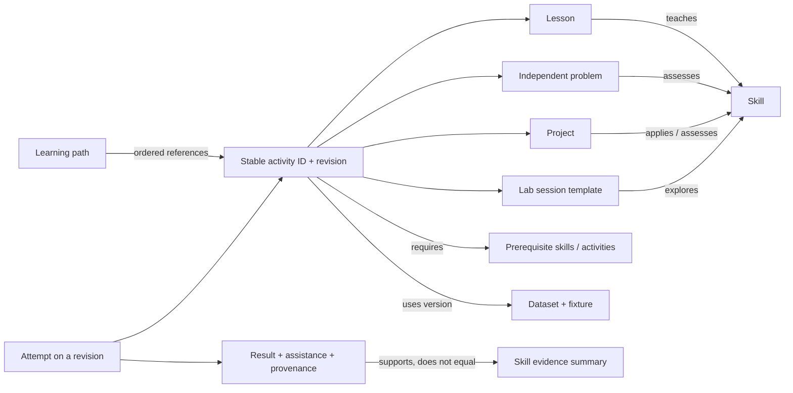

# Learning model: activities connected by skills and evidence

Research date: **2026-10-20**. Scope: repository source inspection and published research; no curriculum changes, participant study, or production verification. **Verified finding** means directly inspected source or publication; **inference** is a reasoned interpretation; **proposal** is a future design; **unknown** marks missing evidence. Existing activity counts, wording, question banks and projects remain unchanged.

## Decision

**Proposal:** retain distinct lessons, independent practice, projects and labs, connected through stable activity identities, versioned dataset references and explicit skill relationships. A path orders references to those activities; it does not own copies. Share execution and evidence services while preserving each activity's educational purpose. Completion, successful execution and mastery are different facts.

This supports `Learn → Practice → Build → Experiment → Review` without making it a compulsory linear funnel. Experienced learners can start at practice or a project and follow prerequisite links when needed. Beginners receive a recommended route, worked examples and progressively reduced guidance.

## Verified starting point

| Finding in local code | Evidence | Consequence |
| --- | --- | --- |
| SQL lessons already have concept, example, trap, hints, prerequisites, walkthrough, dataset reference, tasks and quiz. | [`Lesson` and `Challenge`](../../../src/content/types.ts) | Adapt existing records; do not replace a mature curriculum with a new content system. |
| SQL lesson UI composes explanation, runnable walkthrough, two challenge tabs and concept check; examples explicitly do not count toward progress. | [`Lesson`, `Session`, `idealTab`](../../../src/features/rt/pages/Lesson.tsx) | Preserve existing completion semantics and saved position while introducing presentation adapters. |
| Practice already models write, predict and debug; difficulty has an explanatory rubric field. | [`ExerciseType`, `BankQuestion`, `QuestionRecord`](../../../src/content/question-bank/types.ts) | V2 extends existing taxonomy, rather than claiming all practice is currently write-code. |
| SQL projects model orientation, checkpoint, exploration, build, synthesis and report, with requirements for findings/evidence distinct from validation. | [`ProjectStage`, `ProjectStageValidation`, `Project`](../../../src/content/projects/types.ts) | Engineering judgment already has a foothold; preserve it instead of reducing projects to test counts. |
| SQL progress tracks assistance/exposure and reviews, with `REVIEW_DAYS = [1, 3, 7, 21]`. | [`AttemptState`, `ReviewState`, `REVIEW_DAYS`](../../../src/lib/learning-state.ts) | Spaced review is an existing capability; assess its effectiveness before replacing its scheduler. |
| Python V2 has separate lesson, exercise, project, milestone and playground records, content versions and independent/assisted flags. | [`Py2Exercise`, `Py2Lesson`, `Py2Project`, `isLessonMastered`](../../../src/lib/python-progress-v2.ts) | Normalize concepts across subjects while retaining legacy keys and semantics. |
| Python project files carry between milestones; read-only provided files are presented alongside editable files. | [`ProjectScreen`](../../../src/features/python/Project.tsx) | Cross-stage continuity does not require a new IDE or remote filesystem for every project. |
| Python tools include Playground, Comparator, DatabaseLab and PerformanceLab source modules. | [`workspace.ts`](../../../src/features/python/workspace.ts), [`Comparator.tsx`](../../../src/features/python/Comparator.tsx), [`DatabaseLab.tsx`](../../../src/features/python/DatabaseLab.tsx), [`PerformanceLab.tsx`](../../../src/features/python/PerformanceLab.tsx) | Audit and reuse these before adding speculative tools. Presence in source is not proof of launch readiness. |

**Unknown:** learning gains, learner abandonment points, actual accessibility outcomes and deployed coverage were not established by inspecting these modules. A source implementation is not evidence that learners understand it.

## Educational evidence and limits

All sources accessed **2026-10-20**.

- **Verified publication:** the [IES practice guide, Organizing Instruction and Study to Improve Student Learning](https://ies.ed.gov/ncee/wwc/PracticeGuide/1) recommends spacing, alternating worked examples with problem solving, retrieval and explanatory questions. It rates spacing and worked-example interleaving as moderate evidence, re-exposure through quizzes and deep explanation as strong evidence, and pre-questions as minimal evidence. These are general educational findings, not a runtime.school evaluation.
- **Verified publication:** [Sentance, Waite and Kallia, Teaching computer programming with PRIMM (2019)](https://doi.org/10.1080/08993408.2019.1608781), also available through the [authors' university repository](https://eprints.gla.ac.uk/229013/), examines Predict, Run, Investigate, Modify, Make in 13 schools with 493 learners aged 11–14. **Inference:** tracing and modification are credible additions between explanation and independent coding. The population and classroom dialogue differ from adult self-directed online learning; do not transfer effect sizes or claim this validates V2.
- **Verified publication:** [IES, Optimizing Resistance to Forgetting](https://ies.ed.gov/use-work/awards/optimizing-resistance-forgetting) reports that spacing effects and useful intervals depend on retention horizon and task. **Proposal:** retain a simple explainable scheduler initially; measure delayed transfer before introducing adaptive models. No evidence here determines a universal best interval for SQL or Python.

**Proposal, not a research finding:** select block composition by the lesson's observable objective. No reviewed evidence establishes that exactly two challenges is optimal for every concept. Equally, no evidence justifies changing the existing two-challenge curriculum now.

## Relationship model

**Proposal:** distinguish *teaches*, *practises*, *assesses* and *requires*. A page mentioning a join should not award join mastery. Skill IDs identify observable capabilities such as `sql.join-preserve-unmatched`, not merely broad labels such as “advanced.” Start with curated mappings for existing SQL/Python activities; avoid a graph database or exhaustive ontology. Keep prerequisite cycles out of the recommended sequence; optional links can be cyclic.

Identity example, illustrative only: a path step can reference `subject=sql, activity=<existing lesson ID>, revision=<mapped content revision>` with an optional mode. Preserve native IDs behind a namespaced reference; do not renumber existing records. A practice attempt opened from a lesson and from a path points to the same activity. Its launch context changes navigation, not correctness rules or award identity. Runnable examples can have local block IDs; they do not need separate searchable activities unless independently reusable.

Dataset identity references the canonical dataset, edition/version and fixture, not an embedded new dataset per activity. **Proposal:** SQL tables and Python files should become documented representations of a shared scenario, with engine-specific setup declared explicitly. Current catalogs are separate; dataset equivalence across them was not verified. Matching names do not prove equivalent null, timestamp or numeric semantics; cross-subject work must state those differences.

## Lessons

**Proposal:** an editorial flow with a shared minimum contract, not an identical page template for every subject.

| Block | Educational role | Interaction and evidence |
| --- | --- | --- |
| Objective and prerequisite links | Tell learners what they will be able to do and where to repair gaps | No credit for reading or opening links |
| Concept with concrete example | Connect an idea to a meaningful scenario | Small visible dataset/schema; accessible text alternative for diagrams |
| Prediction or trace | Require a model of execution before seeing output | Record response separately from subsequent code runs; optionally request an explanation |
| Runnable worked example | Let learners inspect cause and effect | Run against declared fixture; show actual output and changes; no mastery award |
| Modify/debug exercise | Reduce blank-page burden while applying one concept | Mark assistance context; gradual removal of starter scaffolding in later activities |
| Independent challenge | Elicit a solution without worked-answer support | Check records versioned outcome; Run only experiments |
| Concept check and reflection | Detect a misconception beyond a lucky passing query | Explain distractors; let learners retry without shaming |
| Next step | Connect lesson to relevant practice or project use | One recommended continuation plus optional alternatives |

A lesson should fit one coherent objective or a tightly related group; no arbitrary word/page quota. Keep explanation adjacent to the runnable example it explains. Collapse optional deep detail and large dataset previews, never required instructions. Long lessons have a local outline and resumable sections. Do not mount a live editor for every static code example before it is needed.

Current two challenges and concept checks remain exactly as authored. Future authoring may declare completion requirements by stable block IDs, with existing SQL and Python mapped to their present rules. This decouples future policy from array length without changing historical credit. A “read” state, a “completed with help” state and an independent evidence state must remain distinguishable.

**Beginner route:** explanation → predict/trace → run/inspect → modify → independent challenge. **Experienced route:** direct challenge with optional explanation, schema and hints. Placement can recommend a starting point but should not permanently lock lessons. Skipping an explanation is not itself a mastery award.

## Independent practice

Practice asks the learner to retrieve and select a method without the lesson's immediate answer context. It should link back to concepts, not silently duplicate lesson tasks with new IDs and awards.

| Problem type | Required submission | Feedback boundary | Now / later |
| --- | --- | --- | --- |
| Write code | Query/program/function satisfying a contract | Output differences and public case diagnostics | Now; existing capability |
| Debug code | Corrected starter plus optional diagnosis | Explain failing behavior; avoid requiring one specific textual fix | Now; existing taxonomy |
| Predict output / trace | Structured answer before execution | Compare prediction with actual trace after commitment | Now; existing SQL taxonomy |
| Optimize | Semantically equivalent solution plus plan/measurement | Correctness first; repeated measurements with stated environment; no precise speed claim from one browser timing | Next for supported SQL plans; broader benchmarks later |
| Investigate | Query/program evidence plus a written finding | Deterministic evidence checks; qualitative rubric for interpretation | Next using existing project evidence patterns |
| Implement a component | Files/functions plus contract tests | Public examples, edge-case categories, artifact checks | Next for Python; larger environments later |

**Proposal:** discovery filters include subject, skill, difficulty, format, dataset, status (new, in progress, solved, review due) and assistance history. Difficulty should combine prerequisite breadth, independence required, ambiguity and implementation complexity. Reuse existing `difficultyWhy`; validate labels with learner outcomes later. Do not rank difficulty by code length or pass rate alone.

Action semantics:

1. **Run:** execute a captured draft against visible/sample inputs. Show execution outcome; never claim “solved” solely from a successful run.
2. **Check:** execute an immutable submission snapshot against declared grading rules. Record one outcome against that code/content/fixture revision. Edits made during checking belong to a newer draft.
3. **Hint:** reveal progressive conceptual → strategic → concrete help, recording exposure on the attempt. Explain the effect on evidence in plain language; assistance remains legitimate learning.
4. **Reveal:** show a solution with reasoning after an explicit learner action; preserve the draft and mark assistance. Do not overwrite the draft automatically.
5. **Reset:** restore starter as an undoable edit, independently of starting a new attempt. Resetting text must not erase hint history or previous success.
6. **Retry:** begin a new attempt while retaining previous attempts. Immediate repetition after reveal is weak independence evidence; suggest a later review or equivalent unseen item.
7. **Review:** reopen a completed activity in a fresh attempt with historical success retained; show due reason and previous assistance, without showing the answer by default.

Wrong answers should identify the observed mismatch: wrong columns, missing records, duplicates, ordering, null handling, unexpected exception or violated invariant. Explain one actionable next step and preserve the learner's output. Hidden cases may disclose the tested category when safe, but not private values or solution code. Infrastructure failures are neither wrong answers nor valid mastery attempts; allow a retry after recovery.

## Projects

**Verified foundation:** SQL project types already separate checkpoints, explorations and reports. `currentEvidence` and `isEvidenceStale` in [`evidence.ts`](../../../src/features/rt/projects/evidence.ts) compare evidence with query text. `stageIsComplete` has stage-specific rules: orientation requires seen state; report requires seen state and required written sections; synthesis requires written findings and level-specific priority/limitations; exploration counts saved findings; checkpoint/build stages require matching current evidence, validation and a saved finding. It does not require a passing query for every stage. Python `ProjectScreen` maintains the learner's files between milestones.

**Proposal lifecycle:** read brief → inspect data and acceptance requirements → start saved workspace → complete milestone → retain checkpoint → integrate cumulative deliverable → final reproducibility check → export and reflect. Show milestone prerequisites; never discard earlier work when moving forward.

| Level | Scaffolding | Deliverable / assessment |
| --- | --- | --- |
| Beginner | Narrow brief, supplied schema/files, one technique per milestone, clear output contracts | Small working artifact and short evidence-backed explanation; single file/query is sufficient |
| Intermediate | Multiple concepts, less prescribed method, selected data cleaning or edge cases | Integrated queries/scripts with reproducible checks, artifacts and rationale; multiple files only where imports/responsibilities help |
| Advanced | Open tradeoffs, constraints, incomplete assumptions to investigate | Multi-part system or analysis, benchmark/evaluation evidence, documented limitations; human/self-review rubric alongside automated tests |

For executable deliverables, proposed cumulative checking should run current source from a clean documented fixture, not merely add together historical milestone passes. Written synthesis/report and orientation requirements retain their own completion rules; they are not converted into code tests. Preserve “passed previously” while marking affected current milestones “needs recheck” after dependency edits. Only invalidate relevant descendants when dependency metadata is reliable; otherwise conservatively recheck the project. Retain checkpoints by files, fixture/version, runtime identity and accepted evidence, not a live browser heap.

Exports should contain learner source, declared inputs or references, generated artifacts, brief/version and reproduction instructions. Large licensed datasets may be referenced rather than embedded. Checkpoints protect work during experiments; export supports portability without requiring accounts. Existing SQL report/document exports and Python archive facilities deserve reuse after route-specific audit.

Automated checks may evaluate objective properties, such as output schema, deterministic function behavior or successful fresh execution. A rubric evaluates explanation quality, assumptions, maintainability and tradeoffs. Do not convert subjective engineering judgment into a misleading exact percentage. AI feedback, if considered later, is advisory and separately labeled; it is not a V2 dependency.

## Labs

**Proposal:** labs are experimental workspaces with an explicit question or freeform starting point, not a second practice bank. A guided lab may suggest “compare these plans”; a freeform lab may open the same tool and dataset without grading. Both reuse runtime adapters and dataset selection.

Start by organizing existing SQL schema/results/plan workflows and Python Playground, comparator, database and performance tools. A tool deserves its own lab destination when it supports a recurring, distinct investigation with reusable state, not because a component exists. Keep schema previews inside lessons and practice; learners should not navigate away just to inspect columns.

A lab session saves drafts, files, dataset/version, runtime capabilities and optionally selected evidence. Show whether state is fresh or cumulative. Reset environment is separate from reset source. “Send to lab” copies the learner's draft with origin metadata and leaves the original activity/attempt intact. Returning does not silently overwrite the original; offer an explicit import/compare action.

Free experimentation earns engagement history, not mastery. A guided lab with explicit independent assessment can reference an existing assessed activity or emit qualified evidence under that assessment's identity. Avoid awarding credit for execution count or time open. Debuggers, query plans and model evaluation panels appear only when the adapter truly supports them; a printed trace is not a debugger and a local approximation is not distributed Spark execution.

## Paths, progression and mastery

Paths reference existing activities across subjects. They specify purpose, prerequisites, required/optional steps and alternatives. Progress is computed from eligible underlying evidence, so one completed exercise can satisfy multiple paths without multiplying mastery. A path revision retains previous path history; it cannot silently reinterpret an old solve as a new requirement.

A SQL → Python data workflow might refer to an existing SQL aggregate activity, then a Python transformation using the same canonical dataset edition, followed by a project comparing results. This is a proposed relationship, not a new curriculum authored here. SQL expertise can satisfy a domain prerequisite, but not automatically prove Python syntax competence.

Mastery should display the basis of the claim: independent evidence, supported evidence, assessment revision and review recency. Do not make a numeric “82% mastered” claim without calibration. Preserve existing earned badges/lesson states under their historical definitions; introduce richer skill evidence alongside them. Lab sessions and page visits cannot fill missing assessment evidence.

**Important compatibility issue:** `normalizePy2` currently excludes older-version lesson/question records from the active normalized store. A shared V2 migration should archive historical achievements and drafts with original versions, then distinguish “earned previously” from “current assessment needed.” Copying the current normalization behavior into a cross-subject migration would conflict with the requirement to preserve progress. This observation is source-level; no user data was inspected or changed.

## Decisions, alternatives and delivery gates

Complexity is relative: **S** localized metadata/presentation, **M** coordinated content/state changes, **L** cross-runtime or new assessment infrastructure. These are not time estimates.

| Decision / opportunity | Evidence | Recommendation and alternative | Tradeoff / compatibility | Complexity / timing |
| --- | --- | --- | --- | --- |
| Consistent learning without duplicated curricula | Existing typed lessons/practice/projects | Reference graph and thin adapters; reject copying content into each path | Adds identity mapping; leaves all authored items/counts unchanged | M, Next |
| Appropriate lesson variation | IES/PRIMM; current two-tab SQL UI | Keep current rules; allow objective-driven block requirements in future | Authoring validation grows; no immediate content rewrite | S research decision Now; M schema Next |
| Honest evidence of learning | Existing assisted/independent stores | Separate completion, assistance and mastery; reject run-count scores | More state to explain; preserve old achievements | M, Now contract / Next integration |
| Review retention | Existing SQL intervals; IES spacing evidence | Reuse simple schedule, evaluate delayed transfer; defer adaptive prediction | Less personalization, lower complexity | S Now; advanced scheduler Later |
| Realistic project work | Existing stages, evidence and file continuity | Current-source cumulative checks plus rubric; reject only milestone-pass totals | Rechecking costs execution time; keep historical passes | M Next |
| Useful labs | Existing Python tools and SQL project evidence | Capability-specific experiments sharing runtimes; reject a separate lab engine | Discovery curation needed; no new infrastructure necessary | M Next |
| Cross-subject paths | Stable Python IDs and SQL native IDs | Namespaced references; reject global renumbering and cloned courses | Identity migration and revision policy required | M/L Later, after Python readiness |

Before future delivery: demonstrate that a lesson/practice launch shares identity without duplicated credit; assisted retries retain exposure; cancelled checks never mark failure; project edits trigger honest current-evidence status; old progress can be exported/restored; a learner can move from an error to a prerequisite and back to the same draft. Validate learning with delayed novel tasks and qualitative usability sessions, not just immediate pass rate. These are proposed acceptance criteria; no studies or implementation tests were run in this assignment.

Related specifications: [workspace UX](05_EDITOR_WORKSPACE_UX.md), [grading](07_GRADING_SYSTEM.md), [datasets](08_DATASET_ARCHITECTURE.md), [progress and skills](09_PROGRESS_AND_SKILLS.md).
