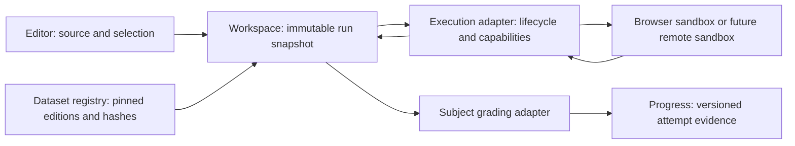

# Execution engine architecture

Research date: 2026-10-20. **Proposal:** retain sql.js and the local Pyodide implementation, introduce a small capability-aware adapter boundary, and make production isolation verification the Python launch gate. A common lifecycle is useful; a universal interpreter or immediate remote execution service is not.

Evidence labels: **Verified** means inspected source or retrieved primary documentation. **Reported** means historical repository evidence, not independently rerun. **Inference** is analysis. **Proposal** is future design. **Unknown** marks missing evidence. No local application engines, application tests, builds, or security probes were executed for this source/architecture audit. Separate public competitor execution observations are recorded in the REA evidence chapter.

## Current implementation, before proposing changes

| Verified source | Behavior and implication |
| --- | --- |
| `src/engine/sql-client.ts`, `executeSql`, `ensureWorker`, `cancelSql` | Browser worker; 12-second startup attempts, three attempts; 60-second canonical dataset load budget; 3-second Run and 8-second reference-answer Check budgets. New execution supersedes the previous request by terminating the worker because worker messages lack request IDs. Keep these protections. |
| `public/vendor/engine.js`, `readFile`, `liveDB`, `makeDB`, message handler | Hash-verified canonical SQLite files, reusable read-only databases, separate write/grading databases, original and changed-data grading, result display capped at 200 rows after comparison. Preserve grading over full results. |
| `src/engine/python/client.ts`, `runPython`, `boot`, `resolveMounts` | Fresh single-use interpreter per run; one global prewarmed spare, replaced when the requested package set changes; 30-second core / 120-second package startup budget; default 5-second execution, 50,000 stdout/stderr characters, 64 MiB mounted dataset limit. Stop terminates the runner; message IDs and random nonces reject stale/forged messages. |
| `src/engine/python/client.ts`, `PyRunResult`, `PyOutputChunk` | Already supports structured syntax/runtime errors, stdout/stderr, figures, tables, files, binary blobs, input files and selectable entry point. Multi-file Python does not require introducing a remote container today. |
| `src/engine/python/sandbox.ts`, `createSandboxWorker`; `public/vendor/python-sandbox.mjs` | Default interpreter factory creates an opaque-origin `sandbox="allow-scripts"` iframe, checks message source, relays to a module worker, removes iframe on termination. This exists locally already. |
| `src/platform/python-sandbox.ts`, `sandboxPolicy`; `public/vendor/python-worker.mjs`, run handler | CSP limits script/network destinations; network constructors are removed before learner code. This is materially stronger than a plain same-origin worker, but source inspection cannot certify security. |
| `src/platform/python-runner.ts`, `pythonRunnerEnabled`; client `allowedHere` | Execution restricted to development, Vercel production/preview explicitly denied, public runtime.school hostnames independently denied. The same-origin description in the gate file is stale relative to the factory: do not mistake it for the current design. |
| `public/vendor/python-worker.mjs`, package bootstrap | `pyspark` resolves to `duckdb.experimental.spark.*`; it is an API-compatible teaching subset, not Apache Spark. |

**Verified test inventory, not fresh pass results:** `tests/sql-client.test.ts` covers supersession, boot retries, timeout, crash recovery and cancellation while loading. `tests/python-client.test.ts` covers fresh interpreters, packages, streams, nonces, timeout, stop, crash and supersession. `tests/python-sandbox.test.ts` covers iframe attributes, message source, relay, termination and CSP text. `tests/e2e/python-isolation.mjs` contains real-browser storage and exfiltration probes. Fake-worker tests establish controller behavior, not browser isolation.

**Gap inferred from code:** Python mounts are fetched before the execution timer and do not have an explicit download timeout in `loadMount`/`resolveMounts`; the aggregate byte limit is checked after download. Add a bounded preparation phase and streaming/declared-size rejection in eventual implementation. Rich outputs and returned files require their own aggregate byte/message budgets; a stdout character limit is not an overall memory limit.

## Responsibility boundaries



**Proposal:** editor owns text, files, diagnostics positions and focus, never security decisions. Workspace owns Run/Check intent, draft revision, selected fixture, cancellation and stale-result display. Adapter owns runtime preparation, transport, resource-policy negotiation and event normalization. Sandbox enforces the limits it can enforce and executes code. Grading owns correctness policies and feedback. Progress records settled attempts and assistance state; worker messages cannot directly mark mastery.

Keep SQL and Python's native types inside adapters. The first migration is a wrapper around existing clients, not moving their core implementations into a framework.

## Minimal contract sketch (documentation only)

```ts
type RuntimeDescriptor = {
  id: string; version: string; adapterVersion: string;
  mode: 'browser-native' | 'browser-wasm' | 'simulation' | 'remote' | 'hybrid';
  capabilities: {
    files: boolean; tables: boolean; figures: boolean; stdin: boolean;
    session: 'fresh' | 'explicit-checkpoint';
    cancel: 'terminate' | 'cooperative-then-terminate';
    memoryLimit: 'enforced' | 'unavailable'; network: 'denied' | 'brokered';
  };
};
type RunRequest = {
  protocolVersion: 1; runId: string; activityId: string; activityVersion: string;
  draftRevision: string; sourceHash: string; runtime: RuntimeDescriptor;
  intent: 'run' | 'check'; entry: string;
  files: Array<{ path: string; bytes: Uint8Array; sha256: string }>;
  fixtures: Array<{ datasetId: string; edition: string; sha256: string }>;
  limits: { prepareMs: number; executeMs: number; outputBytes: number;
            artifactBytes: number; memoryBytes?: number };
  subjectPayload: SqlPayload | PythonPayload; // explicit tagged union, not arbitrary eval
};
// Events always include protocolVersion, runId, draftRevision, sequence.
// Events: phase | stdout | stderr | table | figure | diagnostic | artifact | settled.
// settled: success | syntax-error | runtime-error | timeout | cancelled |
//          superseded | output-limit | preparation-error | crashed | unavailable.
// prepare(descriptor), execute(request, onEvent), cancel(runId), dispose().
```

**Proposal:** unsupported required capability returns `unavailable` with a reason before execution. Never accept `memoryBytes` then imply it was enforced in a browser. Tables carry schema, displayed rows, total rows and truncation; artifacts carry media type, hash, size and safe download handle. Text is rendered as text; do not interpret arbitrary HTML output. Figures are explicitly typed, size limited and sanitized/allowlisted by representation. Input paths must be relative, normalized and forbidden from traversal, reserved fixture locations and excessive nesting.

A grading request adds rubric/test-set version and fixture seed to the same immutable snapshot, not mutable editor contents. Common request IDs are useful even when SQL's legacy worker remains single-flight underneath. No network message bus, plugin loader, RPC framework or event-sourcing system is required.

## Lifecycle and replay

**Proposal:** `idle → preparing → ready → running → settled`. Preparation includes engine, approved packages and fixture verification, with separate visible progress from running code. Cancellation must settle from every phase. Exactly one terminal event is accepted for a run; later events are ignored. A new run explicitly supersedes an old one. Editing after success preserves the old result with “Code changed since this check”; it does not transfer that pass to the new revision.

Timeout terminates browser execution, preserves bounded partial output and rebuilds a fresh interpreter. Do not silently retry learner code after crash: a future remote activity may have brokered effects. Remote cancellation must acknowledge request receipt, enforce a server kill deadline and ultimately reap the process even if the browser disconnects. Session expiry is separate from execution timeout.

Replay identity includes activity/test versions, source hash, runtime/package lock hashes, fixture edition/hash, random seed, timezone/locale and declared inputs. Fresh execution is default for lessons and checks. Labs may opt into persisted files/checkpoints, never accidentally inherit a previous learner attempt's globals. Notebook-like state should be an explicit future capability with restart-and-run-all grading.

## Security launch gate: Python remains blocked until evidence exists

**Reported:** `docs/python/runner-isolation.md` records local Chromium, Firefox and WebKit validation on 2026-10-16. It documents a Firefox EventSource escape from the inherited CSP-only configuration and mitigation by removing network APIs. It also reports regression counts. Those are historical reports, not results from this investigation and not production certification.

**Unknown:** production headers/rewrites, real-device Safari/iOS behavior, current cross-browser teardown guarantees, adversarial memory exhaustion, and resistance to every bridge/network escape. A nonce protects a message protocol; it does not make browser grades trustworthy or establish a complete isolation boundary.

**Proposal, required before public Python launch:** keep the current gate until an authorized validation deployment provides archived evidence for:

1. Actual deployed response CSP, opaque origin, CORS, cache and rewrite behavior, including direct runner navigation.
2. App storage/cookies/DOM inaccessible; credentialed app endpoints and external egress blocked; nested workers, dynamic imports, package loading, bridge references and asynchronous channels challenged.
3. Forged/cross-frame/replayed messages rejected; outputs cannot inject active content; untrusted paths/artifacts stay contained.
4. Infinite loops, output storms, package failure, cancellation during mount/startup, route departure, repeated runs and memory pressure recover acceptably on supported desktop and real mobile browsers.
5. Positive functionality: approved packages, datasets, files, grading, diagrams and normal programs continue working.
6. Documented browser support floor, rollback switch, monitoring/reporting and explicit owner sign-off. Revalidate after sandbox, headers, browser-support or Pyodide changes.

Separate-origin hosting is an alternative if the current opaque-origin approach cannot meet these tests, not an automatic rewrite requirement. Deleting globals alone is not an isolation proof. The user explicitly makes verified production isolation a launch blocker.

## Engine choices and genuine execution boundaries

Primary documentation accessed 2026-10-20; statements below are documented capabilities, not runtime.school benchmarks.

| Subject / workload | Proposed approach | Correctness boundary and cost/complexity |
| --- | --- | --- |
| SQL now | Browser WebAssembly, existing sql.js | Executes SQLite, not every SQL dialect. Existing graders/fixtures work. No server compute; browser downloads and memory still cost. Low incremental complexity. [sql.js](https://github.com/sql-js/sql.js). |
| Larger analytical SQL later | Optional DuckDB-Wasm adapter | Useful analytic engine, but different semantics and packages; requires its own fixtures/dialect label and measured benefit. Browser memory/download limits remain. Medium complexity. [DuckDB-Wasm](https://duckdb.org/docs/current/clients/wasm/overview). |
| Python now/next | Pyodide worker inside verified sandbox | Real Python compiled to WebAssembly with package/platform limits; preserve fresh-run semantics. Cold package startup is material. Medium validation effort. [Pyodide workers](https://pyodide.org/en/stable/usage/webworker.html). |
| JavaScript basics later | Browser-native isolated worker/frame | Never run learner code in app context. DOM projects need isolated preview; Node projects need a different runtime. Node `vm` explicitly is not a security mechanism. [Node vm](https://nodejs.org/api/vm.html). |
| PySpark introduction later | Clearly labeled simulation / compatible API | Existing DuckDB Spark API useful for DataFrame practice; does not teach real executors, shuffles, scheduling or cluster failure. [DuckDB Spark API](https://duckdb.org/docs/current/clients/python/spark_api). |
| Genuine PySpark later | Remote isolated real Spark, hybrid workspace | Start with explicitly labeled single-machine Spark for API exercises; distributed claims require driver/executor cluster tests. JVM startup and resource budgets make this materially costlier. [Spark architecture](https://spark.apache.org/docs/latest/cluster-overview.html). |
| Power BI later | Hybrid external authoring + artifact/rubric assessment | PBIP exposes report/model text definitions; inspecting these is not running DAX, refresh or the full authoring UI. Licensing/execution integration unresolved. Do not promise browser emulation. [Microsoft PBIP](https://learn.microsoft.com/en-us/power-bi/developer/projects/projects-overview). |
| Small ML later | Browser Pyodide for supported small CPU workloads | Real algorithms where approved wheels work. Larger models/GPU/native dependencies require remote execution, with explicit device/package metadata. |
| RAG and agents later | Deterministic simulated tools locally; brokered live remote mode | Simulation validates logic, not live provider/model behavior. Live secrets stay server-side; token/tool/time/cost and egress limits required. No provider needed for V2 SQL/Python. |
| Multi-file engineering later | Existing Python file support first; remote when OS/process/network needed | Files alone do not justify containers. Real builds/services need process/filesystem limits, dependency pinning and artifact export. |

[Official SQLite WASM](https://www.sqlite.org/wasm/doc/trunk/about.md) is another viable engine distribution with worker/storage APIs; nothing found justifies replacing working sql.js now. [Pyodide interrupts](https://pyodide.org/en/stable/usage/keyboard-interrupts.html) require a shared buffer and suitable security headers; retain termination unless measured session needs justify cooperative interruption.

## Remote execution decision, only when a real requirement arrives

**Proposal:** choose a managed isolated execution boundary after requirements/quotas are known. Hardened containers offer process limits and familiar packaging but share host-kernel risk; microVMs introduce a guest-kernel boundary and operational cost. Neither label proves secure tenant separation. [Docker security](https://docs.docker.com/engine/security/) and [Firecracker design](https://github.com/firecracker-microvm/firecracker/blob/main/docs/design.md) describe distinct isolation mechanisms.

Require disposable environments, no app credentials, least-privilege broker tokens, denied-by-default egress, enforced CPU/memory/process/disk limits, image digests, maximum queue age, artifact expiry and cleanup after disconnect. Keep grading secrets in a separate trusted evaluator; never grant learner code control of the grade API. Do not introduce Kubernetes or a bespoke sandbox fleet for SQL/Python V2.

**Unknown costs/performance:** no cold-start, memory or concurrency benchmark was run. Budget later as executions × mean resource duration + idle capacity + storage/egress + provider/model charges. Track p50/p95 preparation/run latency, preparation failure, cancellation recovery and memory-pressure crashes separately by device. Compare representative small/large fixtures before changing engine or adopting paid infrastructure.

## Decision record

| Decision | Problem/evidence | Alternative and tradeoff | Compatibility / complexity / timing |
| --- | --- | --- | --- |
| Keep sql.js | Working query, mutation, schema and plan graders exist | DuckDB or official SQLite distribution may add capabilities but risk semantic migration | Preserves SQL; low; now |
| Wrap clients with capability-aware lifecycle | Different output/error contracts and stale-result risks | Universal runtime hides important differences; independent UIs duplicate lifecycle | Native clients remain; medium; next |
| Verify current Python isolation before launch | Local sandbox exists; historical browser-specific CSP gap and no production proof | Immediate remote Python adds cost; ignoring gate exposes app/users | Keep gate; medium validation, unknown remediation; now |
| Version snapshots and fixtures | Replays/grades need exact inputs | Mutable latest fixtures make results irreproducible | Additive metadata; medium; next |
| Defer remote service and DuckDB-Wasm migration | No demonstrated current need | Premature platform investment increases maintenance | No current behavior change; high later for remote |

See [grading](07_GRADING_SYSTEM.md), [dataset architecture](08_DATASET_ARCHITECTURE.md) and [roadmap](11_MIGRATION_AND_ROADMAP.md).
