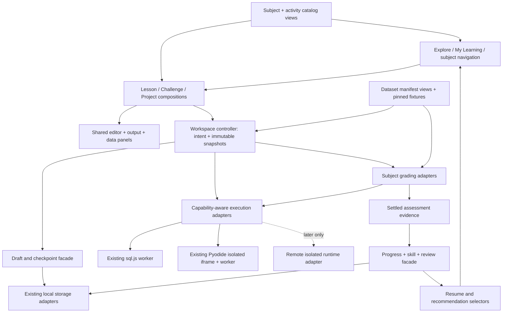

# Platform architecture: one application, shared boundaries, distinct activities

Investigation date: **2026-10-20**. **Verified** describes inspected local source; **proposal** describes future design; **inference** is an interpretation; **unknown** marks a missing validation. This document synthesizes [current state](01_CURRENT_STATE_AUDIT.md), [learning](04_LEARNING_MODEL.md), [workspaces](05_EDITOR_WORKSPACE_UX.md), [execution](06_EXECUTION_ENGINE_ARCHITECTURE.md), [grading](07_GRADING_SYSTEM.md), [datasets](08_DATASET_ARCHITECTURE.md) and [progress](09_PROGRESS_AND_SKILLS.md). No implementation or deployment accompanies it.

## Architecture decision

**Proposal:** evolve the existing Next.js application with small adapters around current catalogs, editors, execution clients, graders and stores. Use distinct lesson, challenge and project compositions. Share identity, workspace lifecycle, draft persistence, result presentation and assessment evidence. Register subject capabilities explicitly; do not force every engine to look like SQLite or every activity to look like a notebook.

Minimum V2 is SQL protected and improved, Python integrated only after production isolation and content readiness are verified, and reusable boundaries ready for further subjects. It does not require accounts, subscriptions, cloud persistence, a new database service, a remote sandbox fleet, a plugin marketplace, microservices or Kubernetes.

## Source foundations and actual gaps

| Verified local foundation | Opportunity / constraint |
| --- | --- |
| [`subjects.ts`](../../../src/platform/subjects.ts) defines availability, destinations, tools, `subjectById`, `availableSubjects`, `lessonRef` and `parseLessonRef`. | Extend this catalog. SQL is available; Python is marked next and links to `/skills/python`. Do not assume this registry already represents current Python development routes. |
| [`Shell.tsx`](../../../src/features/rt/Shell.tsx) has subject-aware navigation, tools, breadcrumbs, theme and palette; Python palette is dynamically loaded. | Reuse shell and lazy loading. SQL and Python menus are currently separately defined; catalog-derived navigation can reduce drift without merging curriculum payloads. |
| [`HomePage`](../../../src/app/page.tsx) renders `Landing` with `pythonAvailable={pythonRunnerEnabled()}`. | Homepage readiness uses a runtime gate separate from catalog availability. Reconcile published navigation through one explicit readiness view; do not simply set Python available. |
| [`Workbench`](../../../src/features/python/Workbench.tsx), SQL [`Editor`](../../../src/features/rt/Editor.tsx), Python [`PyEditor`](../../../src/features/py/PyEditor.tsx) provide substantial reusable UI. | Adapt present behavior instead of replacing the editor framework. Old directory names do not establish dead code. |
| [`sql-client.ts`](../../../src/engine/sql-client.ts), [`python/client.ts`](../../../src/engine/python/client.ts) implement different mature execution lifecycles. | A common request/result envelope should wrap native clients. Existing cancellation, fixtures, quotas and isolation remain authoritative. |
| [`learning-state.ts`](../../../src/lib/learning-state.ts), [`python-progress-v2.ts`](../../../src/lib/python-progress-v2.ts) hold separate histories. | Read adapters first; no destructive single-store rewrite. Preserve SQL project evidence in draft keys as well as legacy project records. |

**Inference:** the largest architectural issue is inconsistent boundaries and evidence semantics across otherwise capable components, rather than missing foundational technology. **Unknown:** performance, device accessibility and production Python isolation were not demonstrated by source inspection.

## Product and navigation model

**Proposal:** keep the global product understandable through two primary destinations: **Explore** and **My Learning**. These are navigation concepts, not instructions to create new routes in this research.

| Destination | Role | Visibility / scope |
| --- | --- | --- |
| Explore / homepage | Understand available subjects and enter a useful activity | SQL first-class. Python enters the available list only after gates pass. Planned subjects may appear in a modest roadmap area, not as empty courses/tools. |
| My Learning | Resume saved work, review due skills, find projects and historical achievements | Local-first, no mandatory account. Clearly say when progress is stored only on this device. |
| Subject Learn | Course outline, placement/recommended next step, editorial lessons | Existing SQL `/sql` and eventual gated Python `/python` remain valid destinations. |
| Subject Practice | Independent problems, filters, review context | Reuse native activity identities; solving from a path and from practice is one achievement. |
| Subject Projects | Briefs, saved projects, milestones and exports | Show only usable projects; avoid empty future cards masquerading as available work. |
| Subject Labs / Tools | Existing experimental tools and dataset discovery | Keep “Tools” initially for compatibility; “Labs” can become the organized destination if usability evidence supports the label. No duplicate menus with the same entries. |
| Learning Paths | Curated routes across existing activities | Later within Explore/My Learning when meaningful paths exist, not a top-level empty destination. |

Breadcrumbs retain subject and activity; a return link preserves the originating list/filter/path. Related links name their purpose: “Review this concept,” “Practise independently,” “Open this draft in Playground.” A handoff creates an explicit copy with source metadata, preserving original progress. Returning from a tool does not silently overwrite an assessed activity.

Capabilities and readiness must be separate. A runtime can support file output while a subject's content is not ready to publish. A lesson can be published while a specialized tool remains unavailable. The navigation view intersects catalog routes, publication status and runtime availability. Future-subject registration should not import its content or engine into SQL pages until needed.

## Modules and dependency direction

All boxes below are **logical modules inside the existing application**, except execution boundaries explicitly labeled. They are not new services.



Dependency rules:

1. Editors know document identity, text, selection, focus and diagnostics. They do not decide whether a solve counts toward mastery or whether a runtime is safe.
2. Compositions know the learning activity and what panels/actions fit it. They do not implement worker transport or duplicate graders.
3. The workspace controller captures immutable source/files, fixture and revision, manages one operation's ownership, and rejects late/superseded results from current UI state. Draft editing may continue during a check.
4. Execution adapters translate native contracts and expose truthful capabilities. A browser worker cannot enforce the same memory/network guarantees as a remote sandbox; descriptor values must say so.
5. Graders retain SQL comparison/state/plan semantics and Python typed/function semantics. Shared evidence structure does not imply shared correctness algorithms.
6. Progress accepts settled evaluated outcomes with assistance/version metadata, not arbitrary runtime “success” messages. A late pass may remain historical evidence for its checked snapshot; edited source remains unverified.
7. Dataset views reference existing manifests and artifacts. No subject receives a mutable global database shared between unrelated learner activities.

## Content contract sketch — documentation only

This sketch describes boundaries, not a ready-to-compile schema or a demand to rewrite all authored content. Existing native schemas remain authoritative during migration.

```ts
// Logical view produced by adapters; existing IDs stay unchanged inside namespaces.
type ActivityRef = {
  subjectId: string;
  kind: 'lesson' | 'practice' | 'project' | 'lab';
  stableId: string;
  contentVersion: string;
};
type ActivityView = {
  ref: ActivityRef;
  title: string;
  href: string;                       // preserves current routes/aliases
  availability: 'available' | 'preview' | 'unavailable';
  workspace: 'editorial' | 'challenge' | 'project';
  nativeContentRef: string;            // adapter resolves existing lesson/problem/project
  skills: {
    teaches: string[]; practises: string[]; assesses: string[];
  };
  prerequisites: Array<{ activity?: ActivityRef; skillId?: string }>;
  datasets: Array<{
    namespace: string; id: string; version: string; edition: string;
    fixtureId?: string; fixtureVersion?: string;
  }>;
  runtimeRequirement?: {
    runtimeId: string; versionPolicy: string; requiredCapabilities: string[];
  };
  assessmentRef?: { rubricId: string; rubricVersion: string };
  completionPolicyRef: string;         // maps present behavior, does not replace it
};
type PathView = {
  id: string; version: string;
  steps: Array<{ activity: ActivityRef; optional: boolean }>;
};
```

Lesson blocks can retain local identifiers; not every paragraph or runnable example belongs in the global catalog. Project completion policy remains stage-specific: SQL orientation, exploration, synthesis and report are not all executable checks. Runtime-less predictions/concept checks are valid activities. A lab can use a challenge/project composition without acquiring an assessment requirement.

**Proposal:** stable activity identity differs from content revision, which differs from code revision, runtime version, dataset edition and rubric version. Record each where relevant; do not use one ambiguous `version` to mean all six. Dataset and skill IDs are namespaced until reviewed equivalence is established. Matching SQL and Python “retail” labels do not prove identical data.

## Execution and grading integration

Retain current sql.js and Pyodide. The execution boundary is defined in [06](06_EXECUTION_ENGINE_ARCHITECTURE.md); do not introduce a second competing universal runtime contract here. Adapters normalize preparation/running/terminal states, streams, tables, diagnostics, artifacts and cancellation. The UI derives actual actions from descriptors. SQL stays SQLite; Python stays its approved package/platform subset. DuckDB Spark-compatible APIs remain labeled simulations, not proof of a distributed Spark engine.

Check freezes the submission and reruns appropriate fixtures under the subject grader. Run remains experimentation. Client-local hidden tests are hidden from normal feedback, not secret from the learner-controlled browser. Trusted remote evaluation is a later option only when assessment requirements justify its cost and trust boundary.

A fresh-run default supports deterministic lessons/practice. Existing SQL state/build tasks reconstruct declared changes; future notebook sessions explicitly expose state/order/restart. No architecture decision here claims all engines can be interrupted cooperatively or have enforceable browser heap limits.

## Persistence, datasets and evolution

**Proposal:** introduce read-through facades over current stores, followed by bounded surface migrations. Export raw legacy payloads and preserve unrecognized records. Add historical/current evidence distinctions without revoking existing achievements. SQL project findings embedded in drafts and older Python project snapshots must not disappear during normalization.

For dataset integration, preserve existing generated manifests, hashes, file formats and runtime loaders. A common metadata view links logical identity to physical representations. Add historical asset retention policy before promising exact replay: current SQL build cleanup can remove older hashed assets. Checksums establish file identity, not logical equivalence between CSV and SQLite.

Local storage remains sufficient until file/artifact sizes or write latency demonstrate a need for IndexedDB. Do not persist unbounded result tables. A future account service synchronizes bounded state and resolves conflicts; it does not retroactively make local achievements authoritative certification.

## Future subject onboarding boundary

A new subject contributes catalog metadata, native content adapter, supported workspace capabilities, runtime adapter if needed, grading policies, dataset representations and progress mappings. It must demonstrate reference/misconception fixtures and lifecycle recovery before appearing as available. Reuse a runtime when semantics truly match; add a distinct adapter for genuine Spark, GPU/large ML, Node process workloads or external BI artifact assessment.

A future subject may need remote isolated execution; that does not require moving existing SQL out of the browser. Power BI authoring and evaluation limitations must be stated explicitly. No unbuilt feature, simulated API or metadata-only artifact check may claim genuine execution equivalence.

## Decisions and proportionality

Complexity: **S** local metadata/presentation; **M** cross-module adaptation; **L** new infrastructure or migration with broad assurance obligations. No time estimate is implied.

| Decision | Evidence / opportunity | Alternative / tradeoff | Compatibility, timing, complexity |
| --- | --- | --- | --- |
| Evolve one app with logical modules | Current shared shell, catalog and editors | Separate subject apps duplicate navigation/progress; a universal monolith hides domain differences | Keep routes/framework; Now architecture, M Next |
| Extend existing catalog with readiness view | `subjects.ts`, homepage gate and Shell currently differ | Hardcoded independent menus drift; immediate catalog rewrite risks visibility regressions | Preserve SQL links and Python gate; Now/Next, M |
| Two global destinations; subject activity navigation | Existing subject-centric Shell and local progress | Seven top-level areas fragment context and expose empty features | No new empty destinations; Next, S/M |
| Keep three compositions | Existing lessons, Workbench and projects; [05](05_EDITOR_WORKSPACE_UX.md) | One universal workspace adds conditional complexity | Keep CodeMirror; Next, M |
| Common identity/evidence, specialized graders | Existing SQL/Python semantics differ | Single correctness algorithm loses types/state semantics | Additive wrappers; Next, M |
| Read adapters before storage migration | Multiple stores and historical project forms | Full rewrite risks drafts and achievements | Preserve old keys; Now requirement / Next work, M |
| Defer remote runtimes/sync/advanced paths | No minimum SQL/Python requirement | Early adoption adds operational cost and launch scope | Later, L when justified |

## Internal consistency review

- Workspace choice agrees with [05](05_EDITOR_WORKSPACE_UX.md): shared foundations do not mean one full-screen shell for every lesson.
- Runtime choice agrees with [06](06_EXECUTION_ENGINE_ARCHITECTURE.md): retain both engines; Python isolation is a launch gate, not presumed absent or proven safe.
- Grading agrees with [07](07_GRADING_SYSTEM.md): a pass applies to a checked snapshot; subjective written project criteria remain rubric-based.
- Datasets agree with [08](08_DATASET_ARCHITECTURE.md): common metadata view, no assumed cross-catalog equivalence or asset rebuild.
- Progress agrees with [09](09_PROGRESS_AND_SKILLS.md): historical achievements and recoverable drafts survive revision changes; no mandatory account.
- Roadmap phases below refer to future work only. No architecture described here has been implemented by this research.
